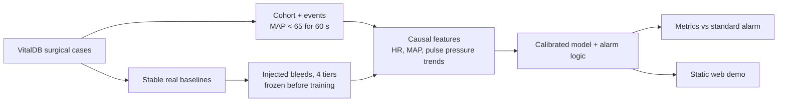

# Drift: catching the vital-sign drift that happens while blood pressure still looks normal

> When a patient is bleeding, blood pressure is the last thing to move. We watch what moves first.

## The problem
Hemorrhage is the leading cause of preventable death after trauma ([PubMed 36551134](https://pubmed.ncbi.nlm.nih.gov/36551134/)). Early on, the body hides it: the heart speeds up and the gap between the two blood-pressure numbers (pulse pressure) narrows, so blood pressure stays normal. When those tricks run out, pressure collapses quickly. Standard monitors alarm on low blood pressure, which means they fire at the collapse, not before it.

## What we built
- **An early-warning engine** that turns the last few minutes of heart rate and blood pressure into a calibrated risk of a low-pressure event in the next 15 minutes. It uses only data up to each moment, never the future.
- **A real-data evaluation** on surgical patients from VitalDB (Seoul National University Hospital), against the standard low-pressure alarm and a tuned blood-pressure cutoff, at matched false-alarm rates.
- **A semi-synthetic test bed:** real, stable stretches of patient recordings, with their real heart-rate wobble and sensor noise, with simulated bleeds injected on top. Here the cause and start of every bleed is known, which real surgical data can't give us. It has four difficulty tiers: textbook, realistic, blunted heart-rate response, and confounded (pain spikes and non-bleeding pressure drops).
- **A static, offline web demo** with two modes: a sped-up replay of a recorded patient, and a simulated bleed you drive with a slider. The demo shows an alert, the standard alarm, and the gap between them. Misses and false alarms are in the case picker too.

## Results
<!-- NUMBERS:RESULTS:START -->
### Real surgical data (VitalDB)
| Method (real surgical data, test set) | Sensitivity | Median lead | False alarms / patient-hour |
|---|---|---|---|
| B1 (standard alarm, MAP<65/60s) | 100.0% | 0.0 min | 0.00 |
| B2 (tuned early-MAP threshold) | 60.1% | 4.4 min | 1.15 |
| Drift (shipped model, early MAP-based alert) | 57.4% | 4.3 min | 0.97 |
| Drift, fresh never-touched holdout (175 cases) | 52.5% | 5.2 min | 0.77 |

Calibration (shipped model, test set): Brier 0.103, AUROC 0.705.

### Simulation (real baselines + injected bleeds; synthetic)
| Tier (simulation) | Bleeds that collapsed | Sensitivity [95% CI] | False alarms / hr | Lead: model | Lead: MAP cutoff | Lead: standard monitor |
|---|---|---|---|---|---|---|
| T1 textbook | 85 | 97.6% [94.3%–100.0%] | 0.65 | 6.7 min | 3.4 min | 5.3 min |
| T2 realistic | 67 | 95.5% [90.2%–100.0%] | 0.66 | 8.3 min | 3.3 min | 7.1 min |
| T3 blunted | 36 | 94.4% [84.8%–100.0%] | 0.48 | 7.2 min | 4.0 min | 1.0 min |
| T4 confounded | 69 | 95.7% [89.6%–100.0%] | 0.74 | 9.2 min | 3.6 min | 5.9 min |
| All tiers | 257 | 96.1% [93.0%–98.9%] | 0.63 | 7.9 min | 3.4 min | 5.0 min |

Pre-registered target (≥ 95.0% at ≤ 1 false alarm/hr on T1 and T2): T1 97.6% at 0.65/hr, T2 95.5% at 0.66/hr, both met on the point estimate (lower CI bounds are below the target). Unseen bleed settings, all tiers: 95.4% at 0.54/hr.
<!-- NUMBERS:RESULTS:END -->

## What we claim, and what we don't
<!-- NUMBERS:CLAIM:START -->
On real surgical data, the shipped early alert caught 57.4% of low-pressure events a median 4.3 min early at 0.97 false alarms per patient-hour (52.5% on a never-touched holdout), about the same as a tuned MAP cutoff (60.1%, 4.4 min). In simulation, heart-rate and pulse-pressure trends warned a median 7.9 min before collapse versus 3.4 min for a MAP cutoff, at 0.63 vs 1.04 false alarms per hour.
<!-- NUMBERS:CLAIM:END -->

- **On real surgical data:** heart-rate and pulse-pressure trends did **not** beat blood pressure alone. We tested this under a pre-registered protocol in three rounds and on a fresh never-touched holdout, so the real-data alert is honestly named an *early MAP-based alert*. Published work found the same thing for a commercial hypotension predictor (Enevoldsen & Vistisen, *Anesthesiology* 2022; Mulder et al. 2024).
- **In simulation, where bleeding causes textbook compensation:** trend-based warning comes about twice as early as a blood-pressure cutoff. It doesn't catch *more* collapses.
- **The gap between the two** is our main finding and our next step: the method needs trauma data with real bleeding labels.
- **We do not claim** that it works in prehospital trauma, that it detects bleeding specifically on real data, that it's clinically validated, or that it's live. It is a research prototype.

## How we kept it honest
- Patients were split so no patient appears in both training and testing. Each test set was evaluated once, and model choices were made on validation data only.
- Before training, we froze the simulator by a fingerprint and wrote down every evaluation rule. We also removed two shortcuts that would have let a model tell bleed from no-bleed without any physiology (noise level and recording-glitch rate).
- The replay never shows anything from the future, and a test re-computes the shown risk from truncated data.
- Everything synthetic is labeled SYNTHETIC; everything real is labeled "Recorded patient, surgical, VitalDB (Korea). Not live."
- No number on the page or in this text is typed by hand; scripts generate them from the results files.

## What's next
- Validation on trauma or ICU data with bleeding-specific labels, such as transfusion need (requires credentialed access).
- Retraining at ambulance cadence: intermittent cuff readings, not continuous arterial lines.
- Clinician input on alarm wording, placement and thresholds.
- A real bedside-monitor feed through the demo's `DeviceSource` interface (documented, not implemented).

## Built with
Python (pandas, scikit-learn, NumPy), VitalDB, plain HTML/CSS/JavaScript, and Claude Code.

## Links
- Code: https://github.com/Palak-Ai-2006/Drift
- Video: _add after recording_

## Data
VitalDB: Lee HC et al., *Scientific Data* 2022, https://doi.org/10.1038/s41597-022-01411-5 (CC BY 4.0).
